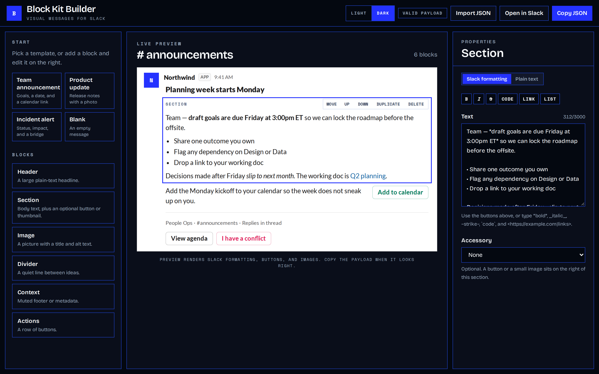
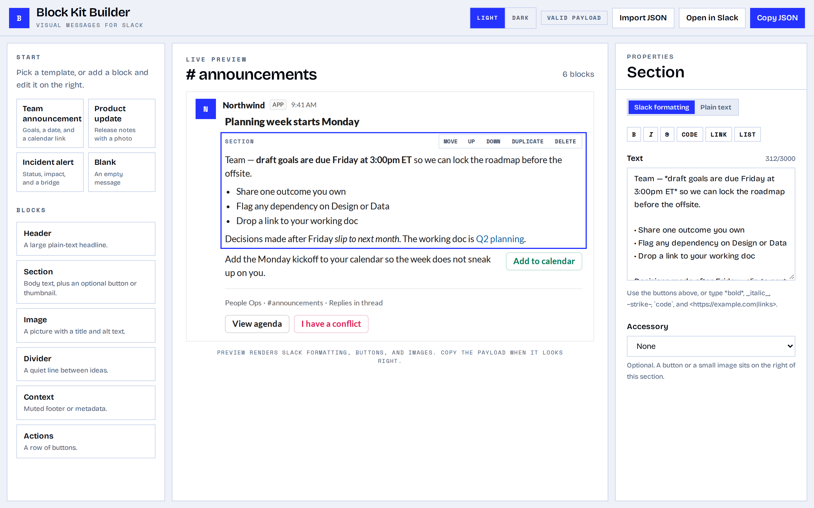
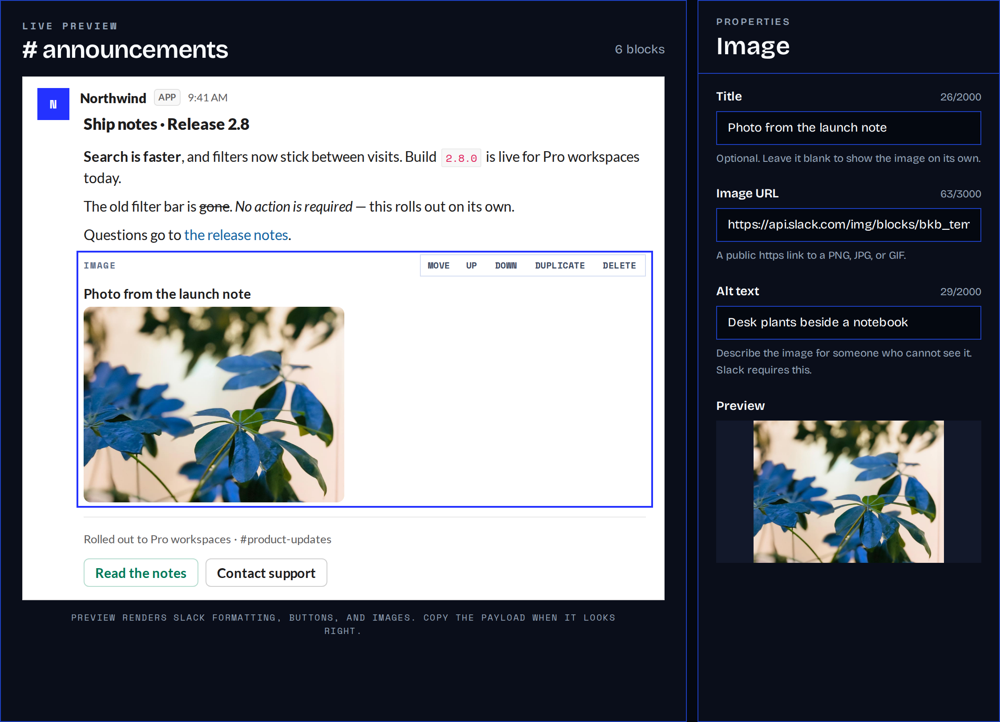
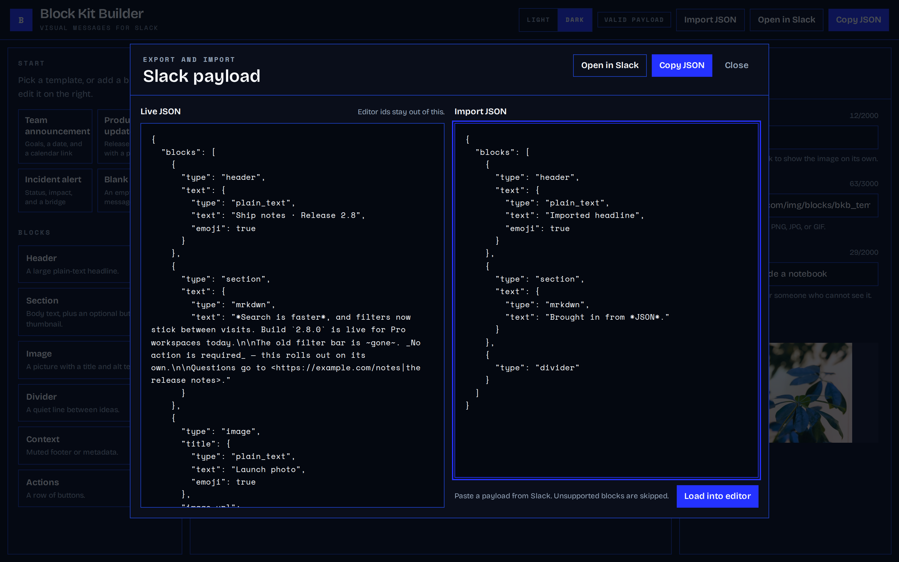

# Block Kit Builder

A visual editor for Slack Block Kit messages. Business users can start from a template, arrange real Slack blocks, and copy a payload that Slack will accept — without hand-writing JSON.

The preview speaks Slack's own formatting: bold, italic, strike, code, links, lists, buttons, images, headers, dividers, and context.

The chrome follows the [Builtanyway](https://builtanyway.io) studio look: sharp corners, electric indigo, Bricolage Grotesque, and Space Mono. Dark is the default. Use **Light** or **Dark** in the header to switch, and the choice is remembered. The Slack message itself stays on a white card so it still reads as Slack.





## What you can do

- Start from **Team announcement**, **Product update**, **Incident alert**, or a blank message.
- Add and edit `header`, `section`, `image`, `divider`, `context`, and `actions` blocks.
- Format section text (`*bold*`, `_italic_`, `~strike~`, `` `code` ``, links, and lists) or switch that section to plain text.
- Attach a button or a thumbnail to a section. Style action buttons as default, primary, or danger, and optionally give them a link.
- Reorder blocks by dragging, or with move up, move down, duplicate, and delete.
- Watch a live `{ "blocks": [...] }` payload. Editor-only ids are never included.
- **Copy JSON**, **import** an existing payload, or **open it in Slack's Block Kit Builder**.





## Supported blocks

| Block | What you edit | What gets exported |
| --- | --- | --- |
| Header | Headline, optional heading level | `header` with `plain_text` (150 characters) |
| Section | Slack formatting or plain text, optional button or thumbnail | `section`, plus a button or image accessory when it is valid |
| Image | Title, public image URL, alt text, and a preview | `image` when the URL and alt text are valid |
| Divider | Nothing — it is just a line | `divider` |
| Context | Up to 10 footer lines | `context` |
| Actions | Button label, default / primary / danger style, optional URL | `actions` with button elements |

Empty required fields stay out of the payload, and the preview says so, so the JSON you copy stays valid. Button links that are not `http` or `https` are left off rather than breaking the block.

## Quick start

```bash
npm install
npm start
```

Open [http://localhost:3000](http://localhost:3000).

```bash
npm test
npm run build
npx playwright install chromium
npm run e2e
```

`npm test` checks serialization and import. `npm run build` writes the production app to `build/`. `npm run e2e` serves that build and runs the editor in headless Chromium, including the screenshots in `docs/screenshots/`.

## A note from Mike

_This is for the general populus that's like me and absolutely hates using the Slack Block Kit Builder GUI_.

## Foreward
_Ignore the fact that I'm writing this like a book, I'm new at coding... forgive me._

This is my first attempt at coding ever, and not going to lie - I built this by working with Claude 3.7 - we'll see how long it takes for me to date myself. Even with the utilization of an AI solution, this was a bit of a struggle for a first attempt. Prior to kicking this off at, I think, 3:20 AM ET, I didn't know much about React, I didn't know much about JS, and I knew very little about GitHub. Now I'm kind of __dangerous__! :) 

## Goals for the Future
I hope this becomes something that I continue to build and eventually share with the larger community of Slack business users who want a GUI to make the overall Slack platform a bit more pretty. I mean, really, Slack/SFDC, is it too much to ask for WYSIWYG? Low-form Markdown is a bit sad in this stage of the game! 

I also plan to document and share this journey, as it took something that has been soul-crushingly low on my list of things to learn and made it into something that I'm __soooo__ hyped for.
